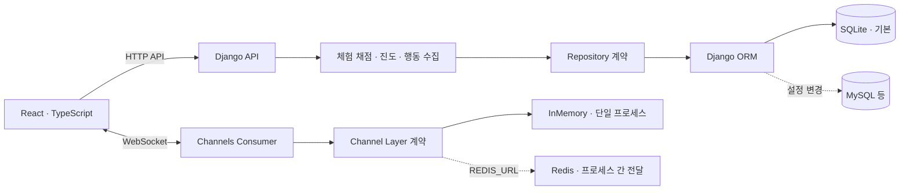

# 아키텍처

차이나 패스포트의 첫 버전은 React·TypeScript 화면, Django API, Django Channels의 WebSocket 통신, SQLite 저장소로 구성합니다. 체험 내용은 학습용 데이터이며 실제 입국·호텔·차량 호출 서비스와 연결하지 않습니다.

## 요구사항과 구현 경계

| 요구사항 | 구현 방향 | 운영 시 확인할 점 |
|---|---|---|
| 동시성 | DB 트랜잭션과 고유 제약으로 중복 완료·중복 이벤트 방지 | SQLite 쓰기 병목, 동시 접속·쓰기 부하 측정 |
| 채팅·소켓 통신 | Channels WebSocket과 채널 레이어로 방별 위치·채팅 전달 | 여러 프로세스에서 실행할 때 공유 채널 레이어 사용 |
| SQLite 기본, DB 교체 | Django ORM과 `DATABASE_URL`로 DB 설정 분리 | 대상 DB에 스키마 생성 및 기존 데이터 이전 필요 |
| 행동데이터 | 세션에 귀속된 구조화 이벤트 저장과 중복 수집 방지 | 보존 기간, 수집 항목, 운영 접근 권한 확정 |
| 확장성·추상 계약 | 데이터 접근 계약과 채널 레이어 뒤에 구현 분리 | 분산 배포에는 공유 DB·Redis·배포 설정 필요 |

## 전체 구조



HTTP API는 세션 생성, 체험 조회·제출, 진도 조회, 행동 이벤트 수집을 담당합니다. WebSocket은 같은 방의 접속 상태, 캐릭터 이동과 채팅을 전달합니다. 화면이 점수나 보상량을 직접 결정하지 않고 서버가 체험 정의에 따라 채점합니다.

## 화면 라우팅과 필드 경계

첫 화면은 분야를 고르는 허브입니다. 허브에서 필드를 선택하면 URL과 화면을 함께 바꾸고, 해당 필드에서만 심사관·데스크 등 체험 지점의 상호작용과 연습을 제공합니다. `여행 가이드`나 `나의 여정`에서 분야를 선택해도 먼저 필드로 이동합니다.

| 화면 | 브라우저 경로 | WebSocket 방 | 주요 역할 |
|---|---|---|---|
| 여행 허브 | `#/hub` | 연결 없음 | 네 분야 입구와 진도 표시 |
| 여행 준비 필드 | `#/fields/prepare` | `prepare` | 준비물·통신·결제 준비 연습 |
| 입국심사 필드 | `#/fields/immigration` | `immigration` | 심사관 응답 연습 |
| 호텔 필드 | `#/fields/hotel` | `hotel` | 가상 예약·체크인 연습 |
| 디디 필드 | `#/fields/didi` | `didi` | 가상 차량 호출·탑승 확인 연습 |
| 여행 가이드 | `#/guide` | 연결 없음 | 체험 내용 안내, 분야별 필드로 이동 |
| 나의 여정 | `#/journey` | 연결 없음 | 완료 상태 확인, 분야별 필드로 이동 |

[`src/lib/navigation.ts`](../src/lib/navigation.ts)에 필드 ID와 경로 해석을, [`src/lib/fields.ts`](../src/lib/fields.ts)에 각 필드의 안내 내용을 모읍니다. 해시 경로를 사용하므로 필드 URL을 직접 열거나 새로고침할 때 서버의 별도 페이지 라우트를 요구하지 않습니다. 브라우저 뒤로·앞으로 가기에서도 URL에 맞는 화면을 복원합니다. 필드 입구 탐색은 API 연결 전에도 가능하지만 체험 제출과 실시간 연결에는 유효한 여행 세션이 필요합니다.

공통 여행 세션·진도는 필드를 옮겨도 유지합니다. 소켓과 접속자·대화 상태는 현재 필드에 귀속하며, 필드를 떠날 때 이전 연결을 닫고 새 필드의 방에 연결합니다. 허브나 안내·여정 화면에서는 소켓에 접속하지 않습니다. 각 필드에는 그 분야의 안내 대상과 체험 진입점만 배치합니다.

## API와 소켓 계약

| 경로 | 인증 | 역할 |
|---|---|---|
| `GET /api/health` | 불필요 | DB 연결 및 실시간 전달 방식 확인 |
| `GET /api/scenarios` | 불필요 | 네 체험의 질문·선택지·설명 조회 |
| `POST /api/sessions` | 불필요 | 익명 세션과 토큰 생성 |
| `GET /api/progress` | Bearer 토큰 | 자기 완료 목록과 누적 XP 조회 |
| `POST /api/scenarios/{id}/attempt` | Bearer 토큰 | 답안·멱등성 키를 받아 서버 채점·기록 |
| `POST /api/events` | Bearer 토큰 | 1~50개 행동 이벤트 수집 |
| `GET /api/events/summary` | Bearer 토큰 | 자기 이벤트 총수와 유형별 건수 조회 |
| `WS /ws/world?token=…&room={fieldId}` | 쿼리 토큰 | 해당 필드 방의 접속·이동·채팅 |

소켓 입력은 `move`·`chat`·`ping`, 서버 출력은 `snapshot`·`presence`·`move`·`chat`·`pong`·`error` 메시지를 사용합니다. 연결 직후 `snapshot`으로 현재 접속자와 최근 대화를 받고, 이후 변경분을 수신합니다. 이동 좌표는 0~100 범위의 유한한 수, 채팅은 공백 제거 후 1~300자로 제한합니다. 현재 서버 제한은 이동 75ms, 채팅 700ms 간격이며 제한보다 빠른 이동은 생략하고 빠른 채팅은 오류로 알립니다.

## 데이터와 동시성

### 영속 데이터

| 데이터 | 목적 | 일관성 기준 |
|---|---|---|
| 여행 세션 | 닉네임·캐릭터와 세션 인증 연결 | 세션별 인증 토큰으로 자기 기록 접근 |
| 체험 제출 | 선택한 답변, 채점 결과, 재요청 식별 | 같은 멱등성 키를 사용한 재전송에서 보상 중복 방지 |
| 체험 완료 | 완료한 체험과 보상 | 세션·체험 조합의 완료를 한 번만 기록 |
| 행동 이벤트 | 체험·화면 사용 흐름 분석 | 이벤트 ID를 통한 중복 수집 방지 |
| 채팅 메시지 | 방의 대화 표시, 최근 30개 메시지 복원 | 분석 이벤트와 별도의 데이터로 취급 |
| 접속 상태 | 방별 캐릭터 위치와 접속 유지 시간 | 연결별 lease로 비정상 종료한 접속을 만료 처리 |

SQLite는 기본 저장소입니다. WAL 모드로 읽기와 쓰기의 간섭을 줄이고 20초의 잠금 대기 시간을 설정합니다. WAL이어도 여러 쓰기 작업을 동시에 실행하는 구조는 아닙니다. SQLite의 쓰기 트랜잭션은 `IMMEDIATE` 모드로 시작하며, MySQL에서는 `select_for_update()`로 해당 여행자 행을 잠급니다. 보상과 완료 처리는 하나의 트랜잭션 및 DB 고유 제약으로 보호하고, 응답 유실에 따른 재요청은 멱등성 키로 처리합니다.

서로 다른 키로 동일 체험을 동시에 제출해도 완료 기록의 고유 제약이 중복 보상을 막습니다. 이 조건은 프로세스 안의 잠금에만 의존하지 않고 DB에 유지합니다. 같은 키에 다른 답안을 넣는 요청은 거부합니다. 같은 키·답안으로 다시 요청하면 기존 채점 결과를 유지하면서 현재 완료 목록과 XP를 함께 반환하므로 이전 요청의 재시도로 화면의 진도가 되돌아가지 않습니다. 예외나 검증 실패로 제출 처리가 끝나지 않으면 일부 보상만 남는 상태가 생기지 않도록 트랜잭션을 롤백합니다.

### DB 교체와 마운트

`DATABASE_URL`을 통해 DB 연결을 바꿉니다. SQLite 파일은 쓰기 가능한 영속 경로에 두고, 컨테이너 운영 시 해당 디렉터리를 볼륨으로 마운트합니다. MySQL 같은 외부 DB로 전환할 때는 애플리케이션 이미지에 DB 파일을 넣는 대신 외부 DB 연결을 설정합니다.

연결 문자열 변경은 데이터 이전을 수행하지 않습니다. 운영 DB 교체에는 대상 DB 생성, Django 마이그레이션, 데이터 내보내기·가져오기, 건수·진도·보상 검증, 전환 시점 관리가 별도로 필요합니다. 새 스키마를 배포할 때도 마이그레이션을 버전 관리합니다.

## 실시간 통신

클라이언트는 익명 여행 세션을 만든 뒤 필드에 입장할 때 토큰과 필드 ID로 WebSocket에 연결합니다. 방은 `prepare`·`immigration`·`hotel`·`didi`로 나누며 다른 필드의 접속자·이동·채팅을 섞지 않습니다. 서버는 방 이름을 소문자로 정규화합니다. 같은 방에 연결된 이용자는 현재 접속자, 위치 변경, 채팅 메시지를 받습니다. 클라이언트가 보낸 값의 길이·좌표·메시지 유형을 서버에서 검증하고, 전송 주기를 제한합니다.

개발 기본값인 InMemory 채널 레이어는 단일 ASGI 프로세스 안에서 사용합니다. 여러 ASGI 워커나 서버에 걸쳐 접속자를 연결하려면 `REDIS_URL`을 지정해 Redis 채널 레이어를 사용해야 합니다. 현재 접속·위치 상태는 공유 DB의 `Presence` 모델에 저장하며, 75초 동안 갱신되지 않은 연결은 조회에서 제외합니다. 여러 서버가 동일한 DB를 사용해야 이 상태를 공유할 수 있습니다.

이동 데이터는 화면 동기화를 위한 현재 상태이며 이동 경로 전체를 저장하지 않습니다. 채팅·완료·행동 이벤트처럼 보존할 데이터는 별도 모델에 저장합니다. 소켓 연결 해제 시 접속자 표시를 정리하고, 재접속 시 최신 상태를 다시 받습니다. 위치 변경도 DB 쓰기를 발생시키므로, 접속자 수와 이동 주기가 늘어날 때는 SQLite의 부하를 측정하고 Redis 등으로 접속 상태 저장을 분리하는 방안을 검토합니다.

## 추상 계약과 확장

[`server/world/contracts.py`](../server/world/contracts.py)의 `TravelerRepository`와 `RoomBroker`는 Python `Protocol`로 정의한 추상 계약입니다. `DjangoTravelerRepository`는 세션·진도·제출·이벤트·채팅 저장을 구현하고, `ChannelsRoomBroker`는 방 참가·퇴장·메시지 발행을 구현합니다. 현재 접속 상태는 `DjangoPresenceRepository`가 담당합니다.

데이터 접근 계약은 서비스 로직이 ORM 쿼리나 특정 DB 드라이버에 직접 의존하는 범위를 줄입니다. 새 저장소를 도입할 때는 계약의 입력·출력과 트랜잭션 의미를 유지하는 구현을 제공해야 합니다. Django Channels의 채널 레이어는 방별 메시지 전달을 InMemory 또는 Redis 구현으로 바꿀 수 있는 경계입니다.

새 체험은 동일한 체험 조회·제출 흐름에 맞추어 콘텐츠와 채점 기준을 추가합니다. 향후 외부 예약 API를 연결한다면 현재 학습용 채점 경로와 별도의 예약 제공자 계약, 인증, 실패·취소·재시도 처리를 도입해야 합니다.

## 캐릭터 이동과 필드 이벤트

`useCharacterController`는 키 입력·터치 입력·클릭 이동을 한 루프에서 처리합니다. `requestAnimationFrame`의 경과 시간으로 위치를 계산하고 대각선 속도를 정규화합니다. 탭 복귀 때의 큰 시간 차이를 제한하고, 포커스 이탈·폼 입력·대화 시작 시 입력과 경로를 정리합니다.

`fieldGeometry`는 필드 바닥, 가구·대기 줄·차량의 발 위치 충돌 영역, 스폰과 NPC 접근점을 정의합니다. `movement`의 순수 함수는 충돌 시 축별 미끄러짐과 A* 경로 탐색을 담당합니다. 클릭은 순간이동이 아니라 경로 예약이며 모든 중간 위치를 충돌 검사합니다. 화면의 방향·걷기 상태는 로컬 입력과 원격 좌표 변화로 표현하고 서버 전송은 기존 100ms 단위 위치 제한을 유지합니다. 충돌 판정은 현재 클라이언트 기능이고 서버는 좌표 범위만 검사합니다.

NPC를 누르면 접근점까지 걸어가고, 가까운 거리에서만 대화를 엽니다. F·E·Space로 상호작용할 수 있습니다. `MissionDialogue`는 인사 → 앱·절차 실습 → 상황별 질문 → 해설 → 보상 상태를 관리합니다. 인사·질문·해설·보상은 하단 JRPG 대화창으로, `stage === "practice"`인 실습은 별도의 `.practice-layer` 작업공간으로 표시합니다. 실습 종료 시 같은 컴포넌트의 질문 단계로 복귀합니다.

글자 출력·선택지·키보드 조작·포커스는 대화 컴포넌트가 담당하고, 채점·보상은 기존 Django API의 멱등 제출 계약을 그대로 사용합니다. 전송 오류 재시도는 같은 답안과 요청 키를 유지하며, 대화 종료 후 늦게 도착한 완료 응답도 전역 진도에 반영합니다.

## 앱·절차 실습 UI

[`ScenarioPractice`](../src/components/ScenarioPractice.tsx)는 `prepare`·`immigration`·`hotel`·`didi`에 맞는 실습을 선택합니다. [`PracticeWorkspace`](../src/components/practice/PracticeWorkspace.tsx)는 중톡이 안내, 진행 설명과 기기 화면을 제공하며, 호텔·디디에는 모바일 앱 프레임, 준비·입국에는 절차 단말 프레임을 사용합니다.

각 실습은 [`PracticeProps`](../src/components/practice/types.ts)의 `onFinish`, `track`, 선택적인 `onGuide` 계약을 사용합니다. `onGuide`는 중톡이의 단계별 안내를 바꾸고, `onFinish`는 실습의 완료 조건을 확인한 뒤 JRPG 질문으로 돌아갑니다. 디디는 추가로 `onRideRequested(request)`를 통해 필드 탑승을 요청하고, 반환된 Promise의 `TaxiBoardingResult`로 성공한 요청·차량 또는 취소를 확인합니다. 호텔의 검색·객실·취소 조건·예약증과 디디의 목적지·승차장·차종은 이전 화면으로 이동할 때 보존합니다. 조건 판정의 공통 순수 함수는 [`practiceFlow`](../src/lib/practiceFlow.ts)에 둡니다.

실습창은 날짜·검색·라디오 선택의 기본 키 동작을 유지하고 대화창의 선택지 단축키를 적용하지 않습니다. `MissionDialogue`의 포커스 제한·Escape 종료·이전 NPC로의 포커스 복원은 새 작업공간에서도 유지합니다. 실습 단계가 바뀌면 기기 화면의 스크롤을 위로 돌립니다. 앱·단말을 조작하는 동안 이동을 정지하고, 디디의 필드 탑승 동안에는 앱을 숨겨 이동을 다시 허용합니다. 두 경우 모두 기존 필드 경로와 방 연결을 유지합니다.

실습의 화면 전환·가상 예약·차량 배정은 브라우저에서 수행하며 외부 예약 API, GPS, 결제 서비스나 NIA 신고 시스템을 호출하지 않습니다. 실습 완료 이벤트는 학습 관찰용이고 서버의 체험 완료·XP 기록을 직접 변경하지 않습니다. 네 실습의 구체적인 단계와 공식 참고 자료는 [실습 UI 설명](practice-ui.md)에 정리합니다.

### 디디의 필드 탑승

가상 호출 후 **차량 진입 → 대기 → 근접 탑승 → 출발 → 앱 복귀**로 이어집니다. [`taxiRide`](../src/lib/taxiRide.ts)는 세 후보 차량, 요청·세션·결과 타입과 단계별 시간, 물리 거리 기반의 탑승 판정을 정의합니다. 배정 정답은 호출마다 후보 중 무작위로 정하며 차량 색상은 구분 단서로 사용하지 않습니다.

차량 클릭은 문 앞 접근점까지 걷는 경로를 예약하고, 가까운 차량은 F 키로 선택할 수 있습니다. `canBoardTaxi`는 대기 단계, 선택한 차량과 배정 차량의 일치, 70 SVG 픽셀 이내 거리를 모두 확인합니다. 잘못된 차량은 거절 후 재선택하게 하며, 원격 탑승·진행 중 중복 탑승·취소된 요청을 완료로 인정하지 않습니다. 취소·필드 이탈 때는 예약된 애니메이션 타이머와 이전 요청의 응답을 정리합니다.

`getTaxiGeometry()`는 기존 디디 바닥·시설에 세 차량의 차체 충돌 영역을 더한 고정 객체를 반환해 경로 탐색 캐시를 유지합니다. 스폰과 NPC 접근점에서 각 차량 문까지 연속해서 걸을 수 있는 경로를 검사합니다. 배차·탑승·문 열림·출발 상태는 개인 브라우저의 훈련 상태이며 다른 플레이어의 예약을 변경하지 않습니다. 필드에서 실제로 걷는 캐릭터 위치는 기존 WebSocket 이동 메시지로 공유합니다.

## 행동데이터와 개인정보

행동 이벤트는 이벤트 ID, 유형, 발생 시각, 구조화된 속성을 포함하고 인증된 여행 세션에 연결됩니다.

```json
{
  "id": "클라이언트에서 생성한 UUID",
  "type": "world_moved",
  "timestamp": "2026-11-16T04:00:00.000Z",
  "properties": { "room": "prepare", "x": 50, "y": 78 }
}
```

서버는 클라이언트가 보낸 `timestamp`와 별도로 DB 저장 시각인 `created_at`을 기록합니다. 두 시각의 의미는 분석에서 구분합니다. 재전송 가능한 ID를 사용해 네트워크 재시도로 인한 중복을 줄입니다. 체험 제출에 따른 `scenario_completed`·`scenario_attempted` 이벤트는 서버가 채점 트랜잭션 안에서 직접 기록합니다. 클라이언트가 보낸 분석 이벤트만으로 완료나 XP를 인정하지 않습니다.

화면 이벤트는 브라우저 메모리에 모아 주기적으로 전송합니다. 전송 실패 시 재시도하지만 대기열 용량 제한, 탭 종료·브라우저 중단으로 유실될 수 있는 최선 노력 방식입니다. 장기 보관이 필요한 원장은 서버의 체험 제출·완료 기록을 사용합니다.

실제 여권번호, 결제 정보, 신분증 사진은 수집하지 않습니다. 실습 이벤트에는 단계·항목 ID, 예시 숙소·목적지 ID, 객실·차종, 인원·숙박일수·연습 총액 등의 구조화된 값만 넣습니다. 목적지 검색 원문과 입력한 날짜, 채팅 본문, 신분정보는 복사하지 않습니다. 준비·입국의 `practice_stage_completed`, 호텔·디디의 `practice_step_completed`, 공통 `practice_action_completed`와 JRPG 복귀 시 `practice_ui_finished`를 상황 문제 채점 이벤트와 구분해 분석합니다. 완료 이벤트의 중복 실행은 실습 컴포넌트의 ref로 제한하며, 서버의 이벤트 ID 중복 제거와는 별도의 경계입니다.

익명 세션은 기기 간 계정 동기화 기능이 아니며 브라우저 저장 정보가 사라지면 이전 기록 접근을 복구하기 어려울 수 있습니다.

세션 토큰은 충분한 난수를 사용해 생성하며 DB에는 SHA-256 해시를 저장합니다. 브라우저는 토큰 원문을 보관하고 HTTP 요청의 Bearer 헤더와 WebSocket 연결에 사용합니다. 토큰은 인증 수단이므로 요청·오류 로그에 남기지 않습니다. WebSocket URL의 쿼리로 토큰을 전달하는 구성은 프록시 접근 로그의 쿼리 기록을 제외해야 합니다. 공개 운영 전에는 HTTPS/WSS, 토큰 수명과 복구, 기록 삭제·보존 기간, 채팅 운영 정책을 정해야 합니다.

## 확장 범위와 검증

첫 버전의 목표는 동작하는 단일 서버 MVP와 교체 가능한 구조입니다. 이를 대규모 동시 접속을 처리했다는 성능 보장으로 해석하지 않습니다. 공개 배포 규모를 정하기 전에 다음 조건을 확인합니다.

1. 같은 체험을 병렬 제출해도 완료와 XP가 한 번만 기록되는지 확인합니다.
2. 같은 이벤트 ID를 재전송해도 저장 건수가 늘지 않는지 확인합니다.
3. 서로 다른 세션이 채팅·이동을 주고받고 연결 해제 상태가 정리되는지 확인합니다.
4. API와 소켓에서 다른 이용자의 진도와 인증 정보에 접근할 수 없는지 확인합니다.
5. 실제 사용할 DB와 Redis 조합으로 다중 워커 통신과 재시작·장애 복구를 점검합니다.
6. 예상 접속자 수와 이벤트 발생량으로 지연·실패율·DB 잠금·메모리 사용량을 측정합니다.

자동화된 검증 결과와 실행 방법은 [README](../README.md)에 기록합니다.
